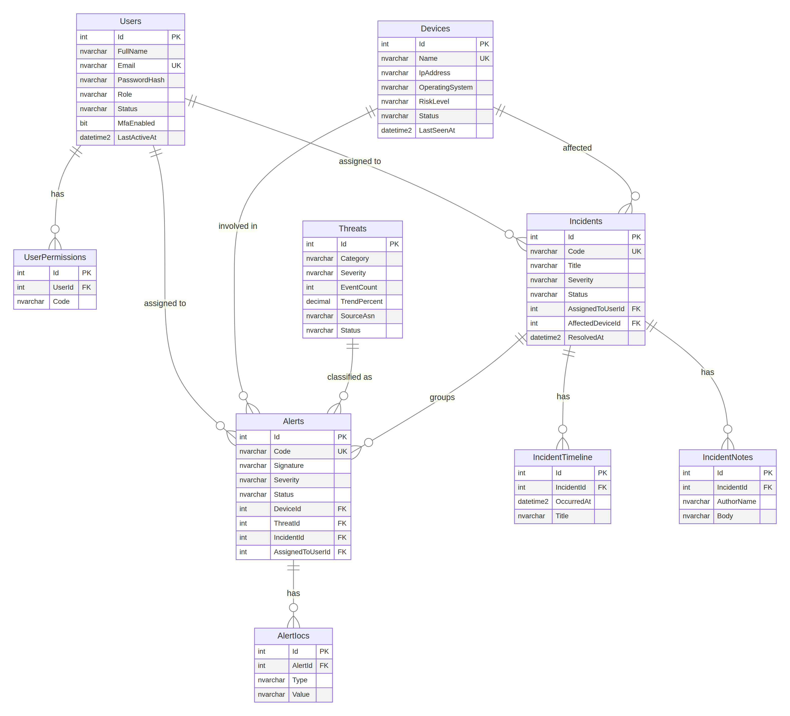

# CyberShield SOC — Backend API

ASP.NET Core 8 Web API · C# · SQL Server · Entity Framework Core · JWT

يخدم شاشات الواجهة التسع (Dashboard, Threats, Alerts, Network, Devices, Incidents, Reports, Users, Settings).
هذه الدفعة تغطي: **Auth + Users + Devices + Threats + Alerts + Incidents + Dashboard**.

## البنية

```
backend/
├── CyberShield.Api/          # مشروع الـ Web API
│   ├── Controllers/          # Auth, Users, Devices, Threats, Alerts, Incidents, Dashboard
│   ├── Models/Entities.cs    # كيانات قاعدة البيانات
│   ├── Data/                 # AppDbContext + Migrations + DbSeeder
│   ├── Dtos/Dtos.cs          # نماذج الطلب والاستجابة
│   └── Services/Services.cs  # JWT, تشفير كلمات المرور, الترقيم
├── database/00_CyberShield_full_setup.sql  # ينشئ القاعدة + الجداول + البيانات (للتشغيل في SSMS)
├── database/01_schema.sql    # الجداول فقط (idempotent)
├── docs/erd.png              # مخطط العلاقات
├── tests/e2e_test.py         # 79 اختبار شامل
└── docker-compose.yml        # SQL Server + API
```

## التشغيل

### الخيار 1 — Docker (الأسهل)

```bash
cd backend
cp .env.example .env        # عدّل SA_PASSWORD و JWT_KEY
docker compose up --build
# API:     http://localhost:5080
# Swagger: http://localhost:5080/swagger
```

### الخيار 0 — الأسهل على Windows (الواجهة + الـ API معًا)

بعد تنفيذ سكربت SSMS (انظر أدناه) افتح CMD داخل مجلد المشروع:

```bat
cd backend\CyberShield.Api
dotnet run
```

يفتح المتصفح تلقائيًا على `http://localhost:5080` فتظهر شاشة تسجيل الدخول. الـ API يخدم صفحات الواجهة من مجلد `public` بجانب `backend`، فلا حاجة لإعدادات CORS.
الاتصال الافتراضي في `appsettings.Development.json` هو `localhost\SQLEXPRESS02` بـ Windows Authentication؛ عدّله إذا كان اسم السيرفر عندك مختلفًا.
الدخول التجريبي: `m.vance@cybershield.internal` / `ChangeMe!123`.

يعمل المشروع على .NET 8 أو أحدث (مثل .NET 10) دون تنزيل شيء إضافي بفضل `RollForward=Major` في ملف المشروع. إذا ظهرت رسالة "You must install or update .NET" فتأكد أنك تستخدم هذه النسخة من الحزمة.

### الخيار 2 — Visual Studio / dotnet على جهازك

1. ثبّت .NET 8 SDK وSQL Server (أو LocalDB / Express).
2. عدّل `ConnectionStrings:Default` في `appsettings.json`، وغيّر `Jwt:Key` (32 حرفًا على الأقل). الأفضل عبر متغيرات البيئة:
   `ConnectionStrings__Default` و `Jwt__Key`.
3. شغّل:
   ```bash
   cd backend/CyberShield.Api
   dotnet run
   ```
   عند أول تشغيل ينشئ التطبيق **قاعدة البيانات `CyberShield` والجداول تلقائيًا** (EF Migrations) ويبذر البيانات الأولية المأخوذة من تصاميم Stitch. للتعطيل: `Database:AutoMigrate=false` و `Database:Seed=false`.

### إنشاء القاعدة من SSMS (ليظهر في Object Explorer)

1. افتح SSMS واتصل بالسيرفر عندك.
2. File ← Open ← File ← `database/00_CyberShield_full_setup.sql`.
3. اضغط **F5**. السكربت ينشئ قاعدة `CyberShield` والجداول التسعة والبيانات الأولية.
4. في Object Explorer: كليك يمين على **Databases ← Refresh** فتظهر `CyberShield` بجانب بقية القواعد.

لاستخدام اسم آخر (مثل `CyberNexus`) غيّر الاسم في السطرين الموسومين `<-- DATABASE NAME` أعلى السكربت. السكربت آمن للتنفيذ أكثر من مرة ولا يكرر البيانات.

بعدها اضبط الاتصال في `appsettings.json` (Windows Authentication):

```json
"ConnectionStrings": {
  "Default": "Server=localhost;Database=CyberShield;Trusted_Connection=True;TrustServerCertificate=True"
}
```

إن كان السيرفر Express فاستخدم `Server=localhost\\SQLEXPRESS`، أو LocalDB: `Server=(localdb)\\MSSQLLocalDB`. وإن كنت تدخل بمستخدم SQL فاستخدم `User Id=...;Password=...` بدل `Trusted_Connection`.

`database/01_schema.sql` يحتوي الجداول فقط (بدون إنشاء القاعدة ولا البيانات) لمن يريدها منفصلة.

## الحسابات الأولية (للتطوير فقط)

كلمة المرور لجميعها: `ChangeMe!123` (تُغيَّر عبر `Database:SeedPassword` **قبل** أول تشغيل).

| البريد | الدور | الحالة |
|---|---|---|
| m.vance@cybershield.internal | Administrator | Active |
| e.rostova@cybershield.internal | SecurityAnalyst | Active |
| s.chen@cybershield.internal / a.mercer@cybershield.internal | SecurityAnalyst | Active |
| d.chen@cybershield.internal | SecurityAnalyst | Suspended |
| s.jenkins@cybershield.internal | Viewer | Pending |

> غيّر كلمات المرور هذه وأوقف البذر في الإنتاج.

## الصلاحيات

| الدور | القراءة | الكتابة (Devices/Threats/Alerts/Incidents) | الحذف + إدارة المستخدمين |
|---|---|---|---|
| Viewer | نعم (ما عدا قائمة المستخدمين) | لا | لا |
| SecurityAnalyst | نعم | نعم | لا |
| Administrator | نعم | نعم | نعم |

المصادقة: `POST /api/auth/login` ترجع JWT؛ أرسله في الترويسة `Authorization: Bearer <token>`.

## الـ Endpoints

| المورد | Endpoints |
|---|---|
| **Auth** | `POST /api/auth/login` · `GET /api/auth/me` |
| **Users** | `GET /api/users` (role, status, search, page, pageSize) · `GET /api/users/summary` · `GET /{id}` · `POST` (إنشاء مستخدم + كلمة مرور مؤقتة) · `PUT /{id}` · `PATCH /{id}/status` · `POST /{id}/reset-password` · `DELETE /{id}` |
| **Devices** | `GET /api/devices` (risk, status, search, sort=lastSeen\|risk\|name) · `GET /summary` · `GET /{id}` · `POST` · `PUT /{id}` · `POST /{id}/isolate` · `POST /{id}/release` · `DELETE /{id}` |
| **Threats** | `GET /api/threats` (category, severity, status) · `GET /summary` (الفئات + ترتيب المصادر ASN) · `GET /{id}` · `POST` · `PUT /{id}` · `DELETE /{id}` |
| **Alerts** | `GET /api/alerts` (severity, status, search, range=24h\|7d\|30d, from, to) · `GET /summary` · `GET /{id}` (مع IOCs) · `POST` · `PATCH /{id}/status` · `POST /{id}/assign` · `POST /{id}/dismiss` · `POST /{id}/isolate` · `POST /{id}/escalate` (يفتح Incident) · `POST /{id}/iocs` · `DELETE /{id}` |
| **Incidents** | `GET /api/incidents` (severity, status, assignedTo, search) · `GET /pipeline` · `GET /{id}` (timeline + notes) · `POST` · `PUT /{id}` · `PATCH /{id}/status` · `POST /{id}/assign` · `POST /{id}/notes` · `POST /{id}/timeline` · `DELETE /{id}` |
| **Dashboard** | `GET /api/dashboard/summary` |
| **Health** | `GET /health` |

كل القوائم ترجع `{ items, total, page, pageSize }`. الأرقام المعروضة في الشاشات (مثل 1,284 مستخدم) تأتي من `/summary` وليست ثابتة.

## قاعدة البيانات



التعدادات (Severity, Status, Role...) تُخزَّن كنصوص مقروءة في SQL Server. أكواد التنبيهات والحوادث (`ALT-9821`, `INC-8915`) فريدة وتُولَّد تلقائيًا.

## ربط الواجهة

أضف عنوان الواجهة إلى `Cors:AllowedOrigins` (الموقع المنشور حاليًا مُضاف مسبقًا)، ثم استدعِ الـ API من صفحات Stitch بعد تسجيل الدخول.

## الاختبار

```bash
python3 tests/e2e_test.py http://localhost:5080   # يتوقع قاعدة بيانات مبذورة حديثًا
```

يغطي 79 فحصًا: المصادقة والأدوار، التصفية والترقيم، الإنشاء والتعديل والحذف، التصعيد من تنبيه إلى حادثة، وعزل الأجهزة.

## ملاحظات أمنية

- كلمات المرور بـ PBKDF2-SHA256 (210,000 دورة).
- لا تضع `Jwt:Key` أو كلمة مرور `sa` في Git؛ استخدم متغيرات البيئة أو Secret Manager.
- استخدم مستخدم SQL محدود الصلاحيات بدل `sa` في الإنتاج، وفعّل HTTPS.
- لا يوجد تقييد لمعدل محاولات الدخول (rate limiting) بعد؛ أضفه قبل الإنتاج.
